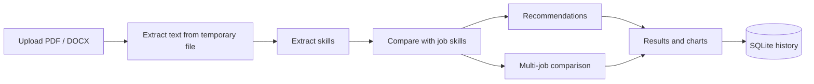

# Research Document: AI Resume Analyzer (CareerFit)

> **Scope of this document.** This is a background and design-analysis document for the AI Resume Analyzer project. Statements about *this project* are taken from the project's README. Statements about the wider field (ATS, NLP, embeddings, fairness, law) are general background, with references listed at the end. Sections marked **Proposed** describe how the project *could* be evaluated or extended; they are not reported results.

---

## Table of Contents

1. [Abstract](#1-abstract)
2. [Introduction and Motivation](#2-introduction-and-motivation)
3. [Problem Statement and Objectives](#3-problem-statement-and-objectives)
4. [Background](#4-background)
5. [Related Approaches](#5-related-approaches)
6. [The Project: What It Does](#6-the-project-what-it-does)
7. [Design Analysis](#7-design-analysis)
8. [Privacy, Security and Data Handling](#8-privacy-security-and-data-handling)
9. [Ethics, Bias and Fairness](#9-ethics-bias-and-fairness)
10. [Proposed Evaluation Methodology](#10-proposed-evaluation-methodology)
11. [Limitations](#11-limitations)
12. [Future Work](#12-future-work)
13. [Engineering Practices](#13-engineering-practices)
14. [Conclusion](#14-conclusion)
15. [References](#15-references)
16. [Glossary](#16-glossary)

---

## 1. Abstract

Job seekers often submit resumes without knowing how well they match a role. Many employers use Applicant Tracking Systems (ATS) that filter and rank applications before a person reads them. AI Resume Analyzer is a Streamlit web application that parses resumes (PDF and DOCX), extracts skills, compares them against job descriptions, compares one resume against up to three roles, suggests missing skills, and stores analysis history in a local SQLite database. It uses the public `all-MiniLM-L6-v2` model for semantic matching. This document reviews the background behind such tools, analyses the project's design choices, discusses privacy and fairness, and proposes a methodology for evaluating the system.

## 2. Introduction and Motivation

Hiring pipelines receive large numbers of applications for each opening, so employers commonly use software to organise and screen them. For candidates this creates two problems:

- **Opacity.** A candidate rarely learns why a resume was not shortlisted.
- **Keyword mismatch.** A resume may describe the right experience using different words from the job description.

Tools that analyse a resume against a job description can give candidates early, low-cost feedback. This project aims to provide that feedback in a simple web interface that can be run locally, in Docker, or on Streamlit Community Cloud.

## 3. Problem Statement and Objectives

**Problem.** Given a resume and one or more job descriptions, estimate how well the resume's skills match each role and tell the candidate what is missing.

**Objectives** (derived from the project's features):

1. Extract text and skills from PDF and DOCX resumes.
2. Compare extracted skills with the skills a job requires.
3. Compare one resume against up to three job descriptions to identify the best fit.
4. Recommend actions for missing skills.
5. Keep a local history of past analyses.
6. Make the application easy to run (local, Docker) and safe to change (automated tests in CI).

## 4. Background

### 4.1 Applicant Tracking Systems (ATS)

An ATS is software that collects, stores and filters job applications. Typical functions include parsing resumes into structured fields, keyword search and ranking. Because parsing quality varies, layout choices (tables, columns, graphics) can affect how well a resume is read. Exact behaviour differs between vendors, so any "ATS score" produced by a third-party tool is an estimate and not a prediction of a specific system.

### 4.2 Resume parsing

Resume parsing converts an unstructured document into structured data (contact details, education, experience, skills). Typical steps:

1. **Text extraction** from the file format (PDF, DOCX).
2. **Cleaning** (whitespace, encoding, headers and footers).
3. **Segmentation** into sections.
4. **Entity and skill extraction.**

PDF is harder than DOCX because a PDF stores positioned glyphs rather than logical paragraphs, and scanned PDFs contain images rather than text.

### 4.3 Skill extraction and matching

Common approaches to find skills in text:

| Approach | Idea | Strength | Weakness |
|---|---|---|---|
| Dictionary / keyword lookup | Match text against a list of known skills | Simple, transparent | Misses synonyms and new skills |
| Rule-based / regex | Patterns for formats such as "Skills:" lists | Predictable | Brittle across layouts |
| Statistical NLP / NER | Trained models tag skill mentions | Handles variation | Needs data and tuning |
| Embedding-based | Compare meaning with vectors | Handles synonyms | Less transparent |

### 4.4 Lexical versus semantic similarity

- **Lexical similarity** (for example TF-IDF with cosine similarity) compares the words that appear in two texts. It is fast and explainable, but "built web services" and "developed backend APIs" share few words despite similar meaning.
- **Semantic similarity** represents each text as a dense vector (an *embedding*) so that texts with similar meaning are close together. Similarity is then measured, typically with cosine similarity.

### 4.5 Sentence embeddings and MiniLM

Sentence-BERT showed that transformer models can be adapted to produce sentence embeddings that are directly comparable with cosine similarity, making semantic search practical. MiniLM is a compressed transformer that keeps much of the accuracy of larger models at lower cost. The project's README states that it uses the public `all-MiniLM-L6-v2` model from Hugging Face for semantic resume matching, downloaded the first time it is needed and cached afterwards. A small model suits a web app that should run on ordinary hardware, including a free hosting tier.

## 5. Related Approaches

Resume-analysis tools generally fall into these categories (general description, not a review of specific products):

1. **Keyword-matching checkers**, which count how many job-description keywords appear in the resume.
2. **ML-based classifiers or rankers**, trained on labelled resume and job pairs.
3. **Embedding-based matchers**, which compare meaning rather than exact words.
4. **LLM-based reviewers**, which use a large language model to critique a resume in natural language.

The project described here combines skill extraction and skill comparison with embedding-based semantic matching, and runs without any third-party API keys.

## 6. The Project: What It Does

All items below come from the project README.

**Features**

- Parses PDF and DOCX files and extracts text and skills.
- Compares extracted skills with required job skills.
- Compares a resume with up to 3 job descriptions at once.
- Gives recommendations for missing skills.
- Saves past analyses in a local SQLite database.
- Visualises results (Pandas and Matplotlib are listed in the tech stack).

**Technology**

Python, Streamlit, SQLite, Pandas, Matplotlib, NLP, pytest, GitHub Actions, Docker and Docker Compose.

**High-level flow**

## 7. Design Analysis

This section explains the reasoning behind choices visible in the project description. It is an analysis, not a record of the team's internal decisions.

| Choice | Benefit | Trade-off |
|---|---|---|
| **Streamlit** UI | Fast to build, pure Python, easy hosting on Streamlit Community Cloud | Less control over layout and state than a full web framework |
| **SQLite** | No separate database server, a single file, simple for a single-user app | Not designed for many concurrent writers; the file must be on a writable, persistent volume |
| **Small embedding model** (`all-MiniLM-L6-v2`) | Low resource use, no API key, runs offline after the first download | Lower accuracy than larger models; needs internet on first run |
| **No external API keys** | No credentials to leak, no per-request cost | Cannot use hosted large models |
| **Docker Compose with named volumes** | Reproducible environment; data and model cache survive rebuilds | Users must understand that `down --volumes` deletes data |
| **Non-root container** | Reduces impact of a container compromise | Requires correct file permissions on mounted volumes |
| **Temporary upload files** | Resumes are not retained after processing | History stores analysis results, so users should know what is saved |
| **Separate local and Docker databases** | Local personal history is not baked into the image | Migration is a manual step |

## 8. Privacy, Security and Data Handling

Resumes contain personal data (name, contact details, employment history), so handling matters.

**What the project does** (from the README):

- Uploaded resumes are read from temporary files that are removed after processing.
- The local database file is git-ignored and excluded from the Docker image.
- The sample `resumes/` directory is excluded from the image and is not mounted into the running service.
- The container runs as a non-root user.
- The application uses no third-party credentials.

**Points worth documenting or verifying**

- Which fields are stored in the history (full text, extracted skills, scores) should be stated clearly to users.
- If the app is hosted publicly, users should be told how long history is kept and how to delete it.
- Sample resumes committed to a public repository should be fictional or have the owner's consent.

**Legal context (general).** Regimes such as the EU GDPR and India's Digital Personal Data Protection Act, 2023 place obligations on organisations that process personal data, including purpose limitation, minimisation and user rights. A student project run locally has fewer obligations than a hosted service handling other people's resumes, but the same principles are good practice.

## 9. Ethics, Bias and Fairness

Automated screening can reproduce or amplify bias. A widely reported example is a recruiting tool at a large company that was reportedly abandoned after it was found to disadvantage women, because it learned from historical hiring data. Regulation of automated employment tools is also emerging; for example, New York City's Local Law 144 requires bias audits of certain automated employment decision tools.

Risks relevant to a resume analyzer:

- **Proxy features.** Names, addresses, universities, or gaps in employment can correlate with protected characteristics.
- **Vocabulary bias.** Candidates from different backgrounds describe the same skill differently; a keyword or embedding matcher may favour familiar phrasing.
- **Over-trust.** A numeric score can feel more objective than it is.

**Mitigations to consider**

1. Present results as guidance for the candidate, not as a hiring decision.
2. Base matching on skills rather than personal attributes.
3. Show *why* a result was produced (matched and missing skills) so users can judge it.
4. Test the matcher on resumes that express the same skills in different ways.

The project is designed for candidates improving their own resumes, which is a lower-risk use than automated rejection of applicants. If it were ever used by employers to screen people, a formal fairness audit would be needed.

## 10. Proposed Evaluation Methodology

> **Proposed.** No evaluation results are claimed in this document. The following is a plan for how the system could be measured.

### 10.1 Skill extraction

- **Data.** A set of resumes (fictional or consented) with skills manually annotated by two or more people.
- **Metrics.** Precision, recall and F1 of extracted skills compared with the annotation.
- **Analysis.** Break results down by file type (PDF vs DOCX), layout (single vs multi-column) and field.

### 10.2 Matching quality

- **Data.** Resume and job pairs with human ratings of fit (for example a 1 to 5 scale).
- **Metrics.** Rank correlation (Spearman) between system scores and human ratings; for the multi-job feature, whether the top-ranked job agrees with the human choice.
- **Baselines.** Compare the semantic approach with a simple keyword-overlap baseline to test whether embeddings add value.

### 10.3 Robustness

- Same content in different layouts and file types.
- Synonym substitution ("JS" vs "JavaScript", "ML" vs "machine learning").
- Scanned or image-only PDFs, which should fail clearly instead of returning misleading scores.

### 10.4 Usability

- Time to first result, clarity of recommendations, and user feedback from a small group of students.

### 10.5 Performance

- Time for the first run (model download) versus later runs (cached model), and memory use in Docker and on the hosting tier.

## 11. Limitations

- Results depend on the quality of text extraction; image-only PDFs contain no extractable text unless OCR is added.
- The semantic model is small and general-purpose; it may handle niche or very new skills poorly.
- First-time semantic matching requires internet access to download the model.
- SQLite suits a single-user deployment better than heavy concurrent use.
- Scores are estimates and do not represent how any specific ATS or recruiter will treat a resume.
- Up to three job descriptions can be compared at once.

## 12. Future Work

Ideas that follow from the design above (none are claimed as implemented):

1. Add OCR for scanned resumes.
2. Build a larger, curated skills taxonomy with synonyms and alias handling.
3. Add section-level feedback (experience, education, projects).
4. Compare a small embedding model with a larger one on the evaluation set.
5. Add export of analysis reports.
6. Add a clear data-deletion control for stored history.
7. Run a fairness check using resumes that express equal skills in different styles.

## 13. Engineering Practices

From the project README:

- **Continuous integration.** GitHub Actions runs `.github/workflows/ci.yml` on pull requests to `main`, pushes to `main`, and manual dispatch. It installs dependencies, checks Python syntax and runs the pytest suite. The required check is the `build` job.
- **Deployment.** The app is hosted on Streamlit Community Cloud, which redeploys when commits land on the configured branch (`main`, entrypoint `app.py`). Actions does not gate that redeploy by itself; branch protection requiring the `build` check enforces it.
- **Containerisation.** Docker Compose provides a reproducible run with a health check on `/_stcore/health`, named volumes for the database and the model cache, and a non-root user.
- **Release flow.** Pull request to `main`, pass the `build` check, merge, automatic redeploy.

## 14. Conclusion

AI Resume Analyzer combines resume parsing, skill matching, multi-job comparison and semantic similarity in a lightweight, key-free application that is easy to run and deploy. Its design favours simplicity and privacy-conscious defaults. The main opportunities are a measured evaluation against human judgement, better handling of synonyms and scanned files, and careful communication that its scores are guidance. This document provides the background and a methodology for taking those next steps.

## 15. References

1. Spärck Jones, K. (1972). A statistical interpretation of term specificity and its application in retrieval. *Journal of Documentation*, 28(1), 11–21.
2. Vaswani, A. et al. (2017). Attention Is All You Need. *Advances in Neural Information Processing Systems (NeurIPS)*.
3. Devlin, J., Chang, M.-W., Lee, K., Toutanova, K. (2019). BERT: Pre-training of Deep Bidirectional Transformers for Language Understanding. *NAACL-HLT*.
4. Reimers, N., Gurevych, I. (2019). Sentence-BERT: Sentence Embeddings using Siamese BERT-Networks. *EMNLP-IJCNLP*.
5. Wang, W. et al. (2020). MiniLM: Deep Self-Attention Distillation for Task-Agnostic Compression of Pre-Trained Transformers. *NeurIPS*.
6. Dastin, J. (2018). Amazon scraps secret AI recruiting tool that showed bias against women. *Reuters*.
7. Regulation (EU) 2016/679 (General Data Protection Regulation).
8. Digital Personal Data Protection Act, 2023 (India).
9. New York City Local Law 144 of 2021 on automated employment decision tools.
10. Sentence-Transformers documentation and the `all-MiniLM-L6-v2` model card on Hugging Face.

> Please check each reference's details (year, venue, wording) against the original source before submitting this document formally.

## 16. Glossary

| Term | Meaning |
|---|---|
| **ATS** | Applicant Tracking System, software that collects and screens job applications |
| **NLP** | Natural Language Processing |
| **Embedding** | A numeric vector that represents the meaning of a text |
| **Cosine similarity** | A measure of how close two vectors are in direction |
| **TF-IDF** | A weighting that scores words by how distinctive they are in a document |
| **NER** | Named Entity Recognition, tagging entities such as skills or organisations in text |
| **OCR** | Optical Character Recognition, extracting text from images |
| **CI** | Continuous Integration, automatically building and testing on each change |
| **Precision / Recall / F1** | Measures of how correct and how complete a system's outputs are |
